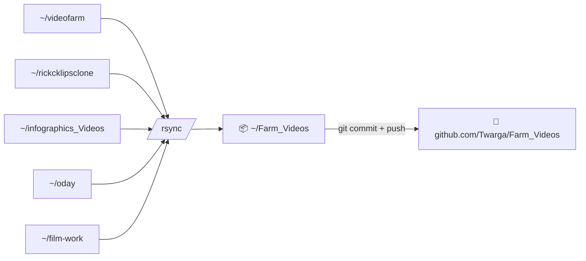

<div align="center">

# 🎬 Farm_Videos

**One repo. Every video project on tlab.**

`subject + title` ➜ *long video* · *3 Shorts* · *thumbnail* · *YouTube metadata* — all generated by machines, all tracked here.

[](https://youtube.com)


</div>

---

## 🗺️ What's inside

| 📂 Folder | 🧩 Role | 🚦 Status |
|---|---|---|
| [`videofarm/`](videofarm/) | **The Farm** — LLM script → Kokoro voice → code-drawn scenes → 1080p render + 3 Shorts + thumbnail + YT text | 🟢 **Active** |
| [`explainer-shorts/`](explainer-shorts/) | **10 finance explainers** drawn entirely in canvas JS — gallery + mp4s | 🟢 Published |
| [`rickcklipsclone/`](rickcklipsclone/) | **Clipper** — slices long videos into Shorts (transcripts → shorts.json) | 🟡 Working |
| [`oday/`](oday/) | Oday factory + video analysis | 🟡 Working |
| [`film-work/`](film-work/) | Film experiments & demos | ⚪ Dormant |
| [`infographics_Videos/`](infographics_Videos/) | First-generation prototype | ⚫ Superseded |

---

## 🏭 videofarm — the live production line

> Give it a subject. Get back a mid-roll-eligible video package.

```
subject + title ──▶ outline ──▶ script ──▶ Kokoro voice ──▶ scenes ──▶ render
                                    │                          │
                                    ▼                          ▼
                            🎙️ -14 LUFS audio          📺 1920×1080 ≥ 8 min
                                                         📱 3 Shorts ≤ 58 s
                                                         🖼️ thumbnail + metadata
```

| ⚙️ Piece | 📍 Where |
|---|---|
| 🌐 Web UI | [`http://192.168.100.26:8686`](http://192.168.100.26:8686) *(tmux session `farmweb`)* |
| 🧠 LLM | local router `127.0.0.1:7187` |
| 🎙️ Voice | Kokoro-82M ONNX — one voice per style |
| 📖 Docs | [`FARM_SPEC.md`](videofarm/FARM_SPEC.md) · [`STYLE_BIBLE.md`](videofarm/STYLE_BIBLE.md) |
| 🎨 Styles | [`styles/professor`](videofarm/styles/professor/) · [`styles/stickman`](videofarm/styles/stickman/) |

```bash
# on tlab, in ~/videofarm
.venv/bin/python -m farm new "subject in plain words" "Title"
.venv/bin/python -m farm suggest <job-id>
```

---

## 🎞️ explainer-shorts — money, in 45 seconds

Every frame drawn **in code** (canvas JS, zero images). Voice: local Kokoro. Music & SFX: synthesized.

Open the gallery: [`explainer-shorts/index.html`](explainer-shorts/index.html)

| # | Title | ⏱️ | 📁 |
|---|---|---|---|
| 1 | Where does your money go? | 42s | [`bank.mp4`](explainer-shorts/videos/bank.mp4) |
| 2 | What is money, anyway? | 44s | [`money.mp4`](explainer-shorts/videos/money.mp4) |
| 3 | Why can't we just print more money? | 43s | [`print.mp4`](explainer-shorts/videos/print.mp4) |
| 4 | What actually happened in 2008? | 44s | [`crash.mp4`](explainer-shorts/videos/crash.mp4) |
| 5 | The most powerful force in finance is boring | 47s | [`compound.mp4`](explainer-shorts/videos/compound.mp4) |
| 6 | One number runs your life | 44s | [`credit.mp4`](explainer-shorts/videos/credit.mp4) |
| 7 | How insurers get rich | 44s | [`insurance.mp4`](explainer-shorts/videos/insurance.mp4) |
| 8 | Where do your taxes actually go? | 47s | [`taxes.mp4`](explainer-shorts/videos/taxes.mp4) |
| 9 | A stock is just a tiny slice | 48s | [`stocks.mp4`](explainer-shorts/videos/stocks.mp4) |
| 10 | One committee, all your prices | 49s | [`fed.mp4`](explainer-shorts/videos/fed.mp4) |

---

## 🔄 How sync works

> ⚠️ **Project folders are auto-mirrors — edit on tlab, never on GitHub.**



- ⏰ **Cron:** `*/5 * * * *` + `@reboot` — survives server restarts
- 🔒 **Lock:** `flock` — no overlapping runs
- ✅ **Pushed:** code · configs · JSON · docs · transcripts
- ⛔ **Skipped:** venvs · node_modules · `.git` · rendered media · files > 25 MB
- 📜 **Script:** `~/Farm_Videos_sync.sh` · excludes `~/sync_exclude.txt` · log `~/Farm_Videos_sync.log`

---

<div align="center">

<sub>Built & farmed on tlab · commits by **Twarga** · 🚜🎥</sub>

</div>
